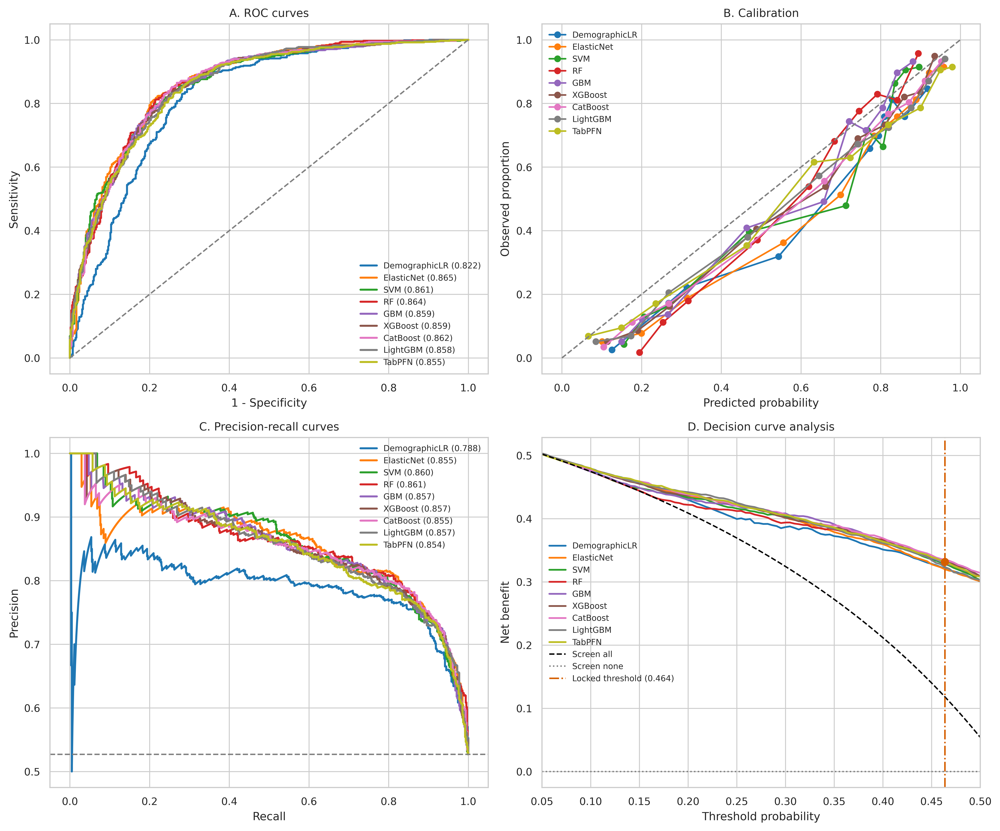
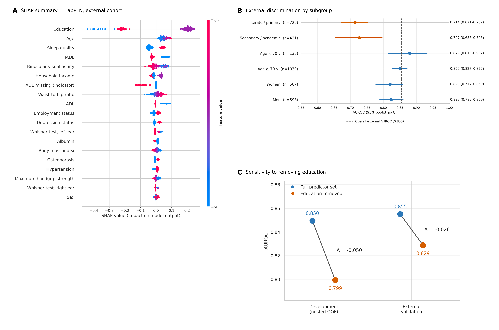

# Moshabeh: prediction of 6CIT-defined cognitive impairment

This repository contains the reproducible analysis code accompanying the Moshabeh study of machine-learning models for identifying **screen-positive cognitive impairment**, defined consistently in both cohorts as a Six-Item Cognitive Impairment Test (6CIT) score **≥8**.

The analysis used PoCOsteo as the development cohort (n=2,000) and Phase III of the Bushehr Elderly Health (BEH) programme as the locked external-validation cohort (n=1,165). The repository contains code only; participant-level cohort data and fitted models are not distributed.

## Analysis overview

- Outcome: screen-positive cognitive impairment, 6CIT ≥8.
- Predictor harmonisation across the two cohorts before modelling.
- Exclusion of predictors with >25% missingness in either cohort.
- Removal of one predictor from highly correlated pairs (absolute Spearman rho ≥0.80).
- Leakage-safe preprocessing fitted within training partitions.
- Nested stratified cross-validation with five outer and three inner folds.
- Comparison of eight candidate algorithms and a demographic logistic-regression baseline.
- Development-derived operating thresholds fixed before external validation.
- Locked external validation without retuning or recalibration.
- Calibration, decision-curve analysis, SHAP, permutation importance, subgroup analyses, and an education-removal sensitivity analysis.

## Repository structure

```text
.
├── notebooks/
│   └── moshabeh_analysis.ipynb
├── src/
│   └── generate_submission_figures.py
├── figures/
│   ├── main/
│   └── supplementary/
├── data/
│   └── README.md
├── environment.yml
├── requirements.txt
└── CITATION.cff
```

The notebook implements the full modelling pipeline. The standalone figure script is the final plotting stage used to create the manuscript figure bundle from the locked notebook objects and outputs.

## Data availability

The individual-level PoCOsteo and BEH data are not included because they contain health information governed by participant consent, institutional approvals, and cohort data-access policies. Researchers seeking access should apply to the respective cohort data custodians and obtain the required ethical and institutional approvals. The expected input files and schema are documented in [`data/README.md`](data/README.md).

## Reproducing the analysis on Kaggle

1. Create a private Kaggle Dataset containing the two authorised cohort files listed in `data/README.md`.
2. Add that dataset as an input to the notebook.
3. Create a Kaggle Secret named `TABPFN_TOKEN` containing an authorised Prior Labs API key, and enable the secret for the notebook. Do not place the token in source code.
4. Use a CUDA-enabled Kaggle accelerator and run [`notebooks/moshabeh_analysis.ipynb`](notebooks/moshabeh_analysis.ipynb) from top to bottom.
5. The notebook writes tables, figures, audit files, locked predictions, and a manuscript-figure ZIP under `/kaggle/working/moshabeh/`.

The analysis was run with a fixed base seed of 42. TabPFN retained its internal `random_state=0`.

## Software environment

The locked analysis used Python 3.12.13 and the core package versions recorded in [`requirements.txt`](requirements.txt). TabPFN v3 was run through `tabpfn==8.5.0` using its default classification checkpoint. A licensed checkpoint and valid API access may be required by the package provider.

## Selected outputs

### External model performance



### Interpretation and education sensitivity



All nine manuscript figures are available in both PNG and PDF formats under [`figures/`](figures/). The study-flow figure is intentionally not included.

## Important interpretation note

The endpoint is a screening classification derived from 6CIT and is not a clinician-adjudicated diagnosis of mild cognitive impairment or dementia. SHAP values and permutation importance quantify model attribution or reliance; they do not establish causal effects. The code and results should not be interpreted as supporting clinical deployment without further prospective evaluation and assessment of local recalibration.

## Code availability statement for the manuscript

> The analysis code used for data harmonisation, model development, locked external validation, calibration, decision-curve analysis, model interpretation, subgroup analyses, and education sensitivity analyses is publicly available in the accompanying GitHub repository. Individual-level cohort data are not publicly available because of participant privacy, consent, and institutional data-governance requirements.

## Citation

If you use this code, cite the accompanying article and archive the exact Git commit used for the analysis. Citation metadata are provided in [`CITATION.cff`](CITATION.cff).

